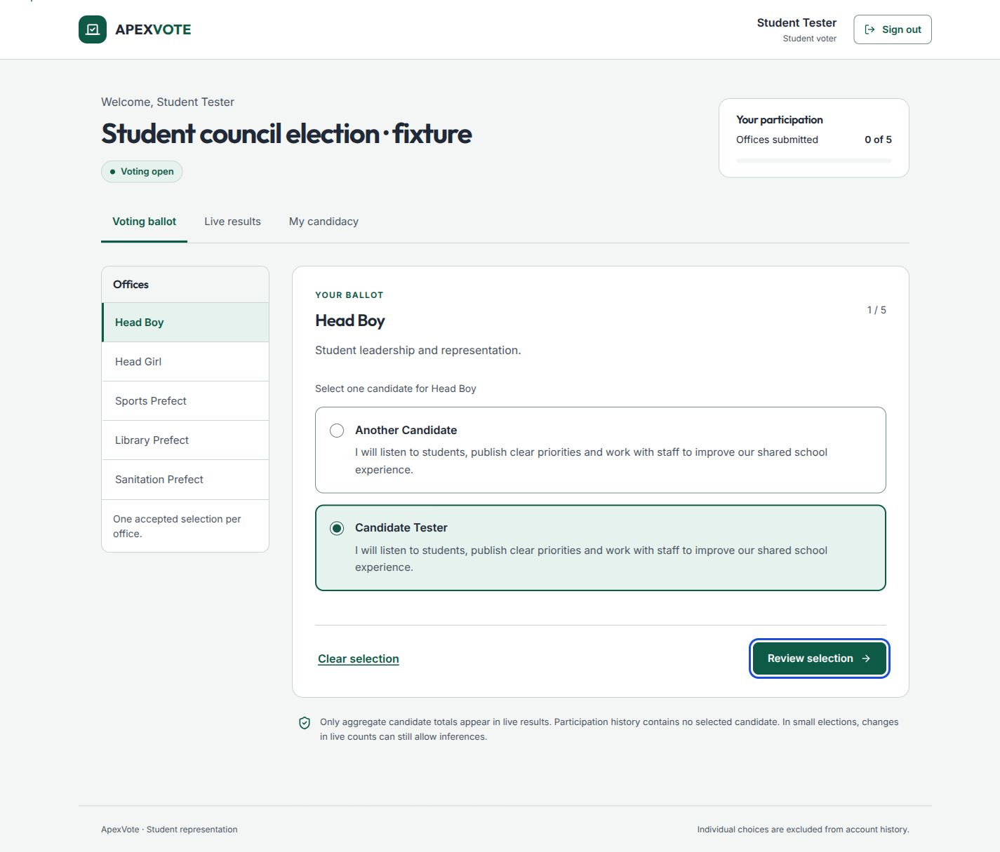
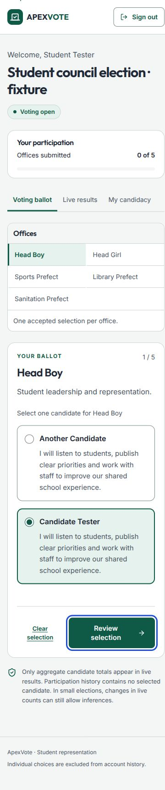
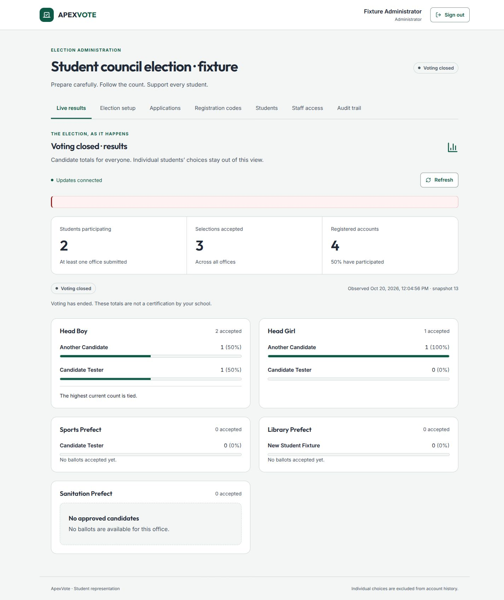

# Verification and rollout boundary

The user approved the staged integrity/live-results scope and the green Superdesign direction. The implementation retains Next.js/React/SQLite, two page routes, the existing five offices, staff roles, enrollment and candidacy. It adds an explicit single-election lifecycle and aggregate-only authenticated student results. No real school brand imagery, enrollment policy, portraits, certification or default credentials are invented.

## Executed checks

- 17 isolated Node tests cover atomic registration, concurrent acceptance, immutable records, role/session foundations, bounded request parsing/origins, private response/schema, window boundaries, legacy refusal, out-of-order snapshots and both cancellation/acceptance arrival orders.
- The localhost HTTP suite uses a fresh disposable database and production build. It covers enrollment, candidate review, roles, cancellation generations, eight simultaneous idempotent requests, aggregate/participation responses, account deactivation preserving counts, irreversible closing and origin rejection.
- A read-only GitHub Actions workflow runs locked installation, syntax checks, integrity/recovery tests, production build and high-severity dependency advisory checks on pull requests and main. Its remote outcome is reported separately from local results.
- Source syntax and production JSX/build checks run. This environment restricts Turbopack's CSS helper socket; the production build was verified with Next's supported `--webpack` option. React 18 is supported by the pinned Next release but emits its documented deprecation warning; a future React 19 migration is separate work.
- Browser verification uses actual synthetic fixtures, never original records. It covers enrollment → application → administrator approval → activation → ballot selection → review/change → acceptance → reload → live results. Interrupted submission, reconnection and zero/tied totals are checked separately. Screenshots and exact completion notes are recorded in the delivery evidence outside the repository.
- Responsive ballot/results checks use 320, 375, 768, 1024 and 1440 CSS pixel widths. Native radios, associated form labels, semantic headings/tables, skip link and visible keyboard focus are implemented. An inline review region replaces the inaccessible custom modal.

These are local checks, not a deployment audit or universal accessibility claim. No production election was opened, closed or migrated.

## Outstanding validation and scope limits

- No real-device Android matrix, assistive-technology session, axe automation, actual browser 200/400% zoom, forced-colors/reduced-motion emulation or school usability study was run. Narrow reflow and keyboard/label checks do not replace those checks.
- No field Core Web Vitals, representative school-load benchmark, multi-process contention test, disk-full exercise, independent penetration test or restore drill was performed. SQLite requires one application instance with durable local storage. Large operational registers still need server pagination; current UI pagination limits rendered rows only.
- One election cycle is supported. There is no reset, automatic next-election rollover, password recovery, roster identity verification or public internet results endpoint.
- Account uniqueness plus single-use codes is not proof of one physical student. The school owns code distribution and enrollment verification.
- Live totals can allow inference in a small electorate. Database/operator access, request timing and backups remain outside an absolute-anonymity guarantee. Existing identity-linked ballots do not become secret retroactively.
- Removing the legacy database from the current Git tree does not remove history. The owner must assess original record provenance and any credential/session exposure separately.

## Before deployment

Confirm the election owner, real eligibility policy, desired schedule, canonical origin/TLS, durable single-instance host, capacity/attempt limits, backup operator and recovery procedures. Explicitly decide whether the committed legacy records are test data or election history. Do not point this branch at a legacy schema or remove that database to make startup succeed.

Rehearse a separately approved migration on a copy. Compare accepted counts and archive an access-controlled original; document retention, identity-link handling, candidate/office mappings and enrollment/session transition. Obtain separate authorization for any production migration and deployment. Do not silently run two incompatible clients against one database.

## Rollback

Before any approved release, back up the exact application version and database together. A failed fresh-instance rollout can be stopped and its unused new database quarantined. After new ballots have been accepted, preserve that database: reverting to the old schema/client or restoring an earlier snapshot would lose votes or restore identity-linked behavior. Use a controlled maintenance pause and forward repair or reviewed data conversion instead. A Git revert cannot undo historical disclosures or recover erased ballots.

## Rendered evidence

These are actual localhost production-build captures using labelled synthetic election fixtures, not production student data. The main layout was checked at all five requested widths.

